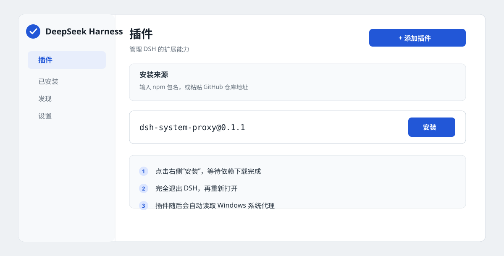
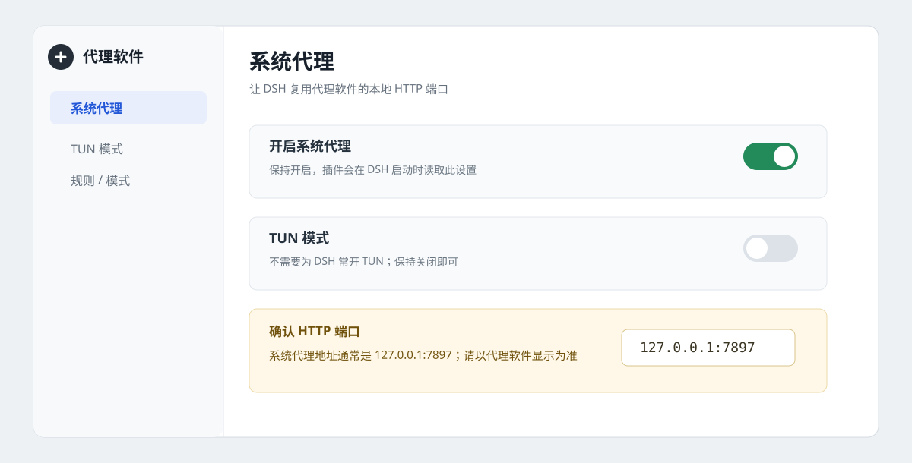
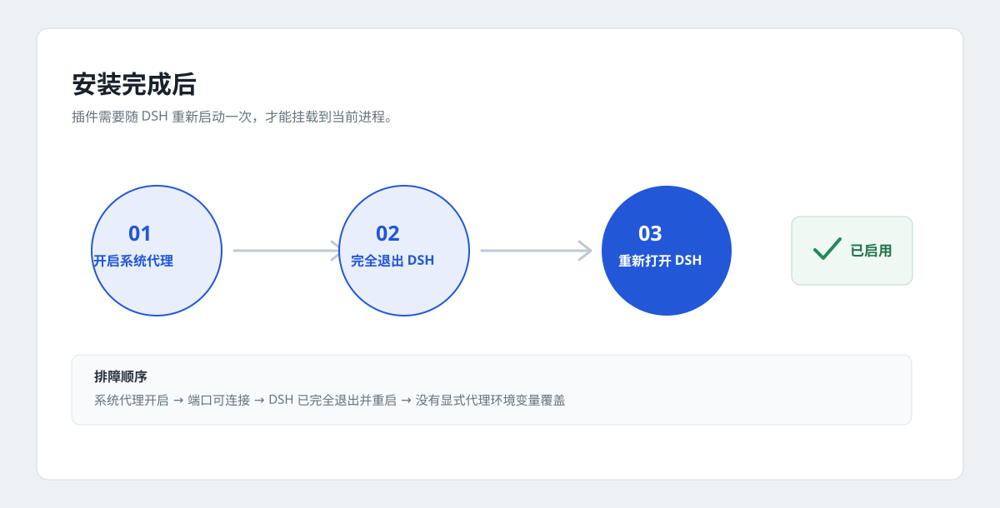

# dsh-system-proxy

Use the Windows system proxy in [DeepSeek Harness](https://github.com/deepseek-ai/deepseek-harness) (DSH). Enable the proxy client's system proxy and HTTP port; no TUN mode is needed for DSH.

> Windows 10/11 and DSH `0.2.1-rc.2` through pre-`0.3.0`. Current version: **0.1.1**, available on [npm](https://www.npmjs.com/package/dsh-system-proxy).

**Coverage:** model requests, Web Search, HTTP MCP, and DSH child processes such as pnpm and git. Electron login/update traffic is not guaranteed to be covered.

## Quick Install

Open **Plugins → Add plugin** in DSH, enter the package name below, and install it:

```text
dsh-system-proxy@0.1.1
```



After installation, **fully quit DSH and start it again**. If a regional npm mirror has not synced, select the official npm registry.

### CLI

```powershell
# dsh on PATH
dsh plugin --profile desktop add dsh-system-proxy

# CLI bundled with the desktop app
& "D:\deepseek-harness\resources\runtime\cli\bin\dsh.cmd" `
  plugin --profile desktop add dsh-system-proxy
```

The source version can also be installed from GitHub:

```powershell
dsh plugin --profile desktop add "github:Bozheng-Li/dsh-system-proxy"
```

## Enable the Proxy

Turn on **System Proxy** in the proxy client and keep **TUN mode off**. The common HTTP port is `7897`; use the address shown by your client.



Full install, restart, and enable flow:



The plugin reads the current user's Windows WinINET system proxy settings, so no proxy address is normally needed.

## Install from the Plugin Market

DSH has no official plugin marketplace yet. Enable **More > Custom plugin markets**, then add this source under **Discover**:

```text
https://raw.githubusercontent.com/Bozheng-Li/dsh-system-proxy/main/market/index.json
```

Search for `dsh-system-proxy` or `Windows proxy`. The index installs a pinned npm version.

## Configuration

The default follows the Windows system proxy. To pin a proxy, edit:

`%USERPROFILE%\.dsh\profiles\desktop\cordis.patch.yml`

```yaml
- id: system-proxy
  config:
    mode: manual
    proxyUrl: http://127.0.0.1:7897
```

| mode | Behavior |
| --- | --- |
| `auto` | Follow the Windows system proxy; default |
| `manual` | Always use `proxyUrl` |
| `off` | Disable the plugin proxy |

Explicit `HTTP_PROXY` / `HTTPS_PROXY` values win over Windows settings. PAC/WPAD is not supported; use `manual` instead. SOCKS cannot be used directly as the system proxy URL; use the proxy client's HTTP or mixed port.

## Check That It Is Active

A successful mount logs:

```text
dsh-system-proxy: using http://127.0.0.1:7897 from Windows system proxy
```

You can also inspect the Windows proxy setting and listening port:

```powershell
Get-ItemProperty `
  'HKCU:\Software\Microsoft\Windows\CurrentVersion\Internet Settings' |
  Select-Object ProxyEnable, ProxyServer

Test-NetConnection 127.0.0.1 -Port 7897
```

If it does not work, check that the system proxy is enabled, the port is listening, DSH was fully restarted, the profile is `desktop`, and no proxy environment variable overrides the setting.

## Uninstall

```powershell
dsh plugin --profile desktop remove dsh-system-proxy
```

Restart DSH afterwards.

## Development

```powershell
pnpm install
pnpm market:generate  # Sync the index after a release
pnpm test
pnpm pack --pack-destination .
```

The index lives at [market/index.json](market/index.json). Commit the package code first, then generate and commit the index.

MIT License · [中文](README.md)
