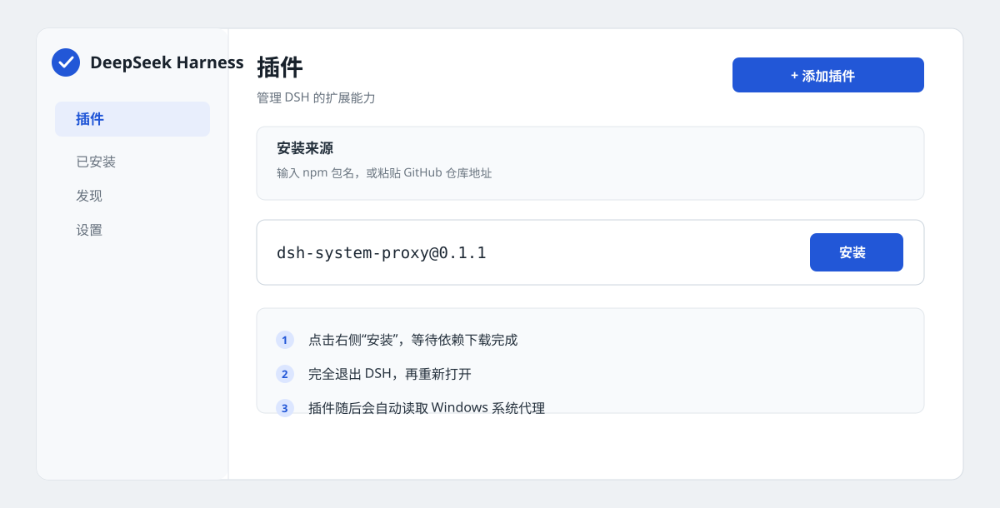
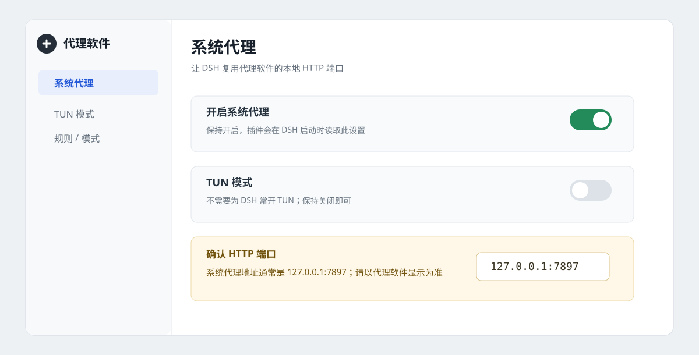
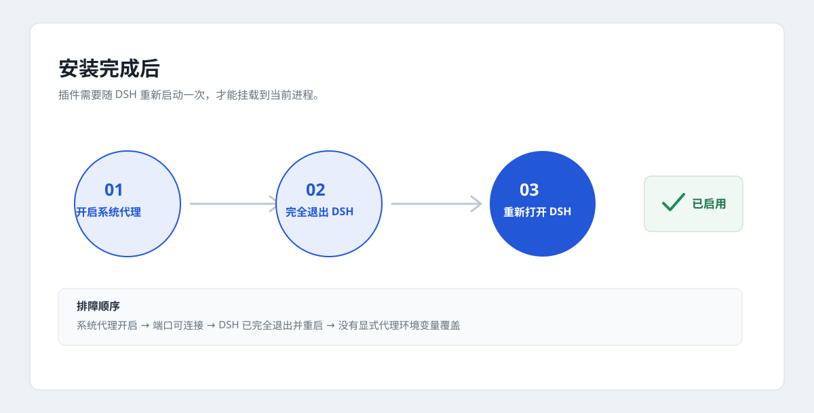

# dsh-system-proxy

让 [DeepSeek Harness](https://github.com/deepseek-ai/deepseek-harness)（DSH）复用 Windows 系统代理。代理软件只开“系统代理”和 HTTP 端口，不需要为 DSH 常开 TUN。

> 适用于 Windows 10/11、DSH `0.2.1-rc.2` 至 `0.3.0` 之前的版本。当前版本：**0.1.1**，已发布到 [npm](https://www.npmjs.com/package/dsh-system-proxy)。

**覆盖范围：** 模型请求、Web Search、HTTP MCP、pnpm 和 git 等 DSH 子进程。Electron 的登录/更新网络不保证覆盖。

## 快速安装

在 DSH 打开「插件 → 添加插件」，输入下面的包名并点击安装：

```text
dsh-system-proxy@0.1.1
```



安装完成后，**完全退出 DSH 再重新打开**。如果使用国内 npm 镜像，镜像尚未同步时请切换到官方 npm 源。

### 命令行安装

```powershell
# dsh 在 PATH 中
dsh plugin --profile desktop add dsh-system-proxy

# 桌面版自带的 CLI
& "D:\deepseek-harness\resources\runtime\cli\bin\dsh.cmd" `
  plugin --profile desktop add dsh-system-proxy
```

也可以从 GitHub 安装源码版本：

```powershell
dsh plugin --profile desktop add "github:Bozheng-Li/dsh-system-proxy"
```

## 启用代理

在代理软件中开启 **系统代理**，保持 **TUN 模式关闭**。常见 HTTP 端口为 `7897`，请以代理软件实际显示为准。



安装、重启和启用的完整流程：



插件会自动读取 Windows 当前用户的 WinINET 系统代理设置，所以通常不需要再填写代理地址。

## 从插件市场安装

DSH 当前没有官方插件市场。打开“插件 → 实验性插件 → 自定义插件市场”，在“发现”中添加索引源：

```text
https://raw.githubusercontent.com/Bozheng-Li/dsh-system-proxy/main/market/index.json
```

然后搜索 `dsh-system-proxy` 或“系统代理”。市场索引安装的是 npm 上的固定版本。

## 配置

默认跟随 Windows 系统代理。需要固定代理时，编辑：

`%USERPROFILE%\.dsh\profiles\desktop\cordis.patch.yml`

```yaml
- id: system-proxy
  config:
    mode: manual
    proxyUrl: http://127.0.0.1:7897
```

| mode | 行为 |
| --- | --- |
| `auto` | 跟随 Windows 系统代理；默认 |
| `manual` | 固定使用 `proxyUrl` |
| `off` | 不使用插件代理 |

显式 `HTTP_PROXY` / `HTTPS_PROXY` 优先于 Windows 设置。PAC/WPAD 不支持，请使用 `manual`。SOCKS 不能直接作为系统代理 URL，请使用代理软件的 HTTP 或 mixed 端口。

## 确认是否生效

DSH 启动日志出现下面这一行，表示插件已接管：

```text
dsh-system-proxy: using http://127.0.0.1:7897 from Windows system proxy
```

也可以检查 Windows 的代理设置和端口监听：

```powershell
Get-ItemProperty `
  'HKCU:\Software\Microsoft\Windows\CurrentVersion\Internet Settings' |
  Select-Object ProxyEnable, ProxyServer

Test-NetConnection 127.0.0.1 -Port 7897
```

没有生效时依次确认：系统代理确实开启、端口在监听、DSH 已完全退出并重启、当前 profile 是 `desktop`、没有被 `HTTP(S)_PROXY` 覆盖。

## 卸载

```powershell
dsh plugin --profile desktop remove dsh-system-proxy
```

然后重启 DSH。

## 开发

```powershell
pnpm install
pnpm market:generate  # 发布新版本后，同步 market/index.json
pnpm test
pnpm pack --pack-destination .
```

索引文件是 [market/index.json](market/index.json)。发布流程应先提交代码，再生成并提交索引。

MIT License · [English](README.en.md)
